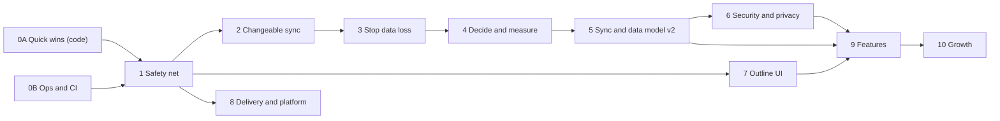
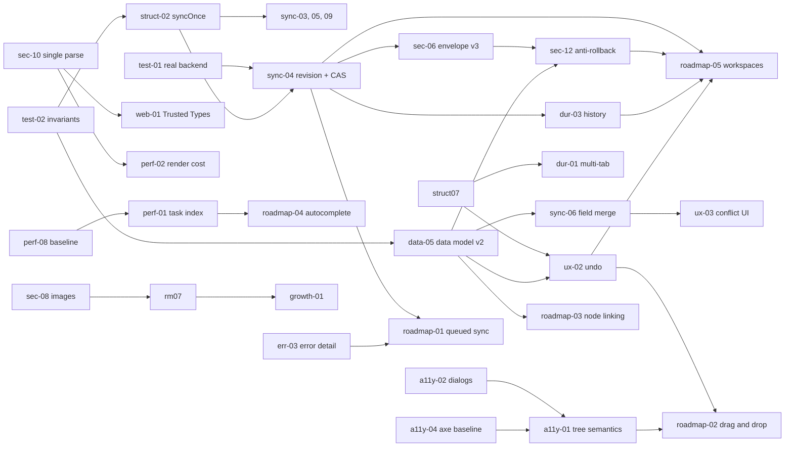

# Virgulas review roadmap

Ordered plan for the findings from the 2026-10-01 codebase review. None of these are tickets yet; this folder is where they are reviewed first.
Completed items are deleted from this folder once merged; their history lives in the git commits and GitHub pull requests.
Each item has its own file with a description, evidence and a suggested fix, plus a "Roadmap position" block with its phase, size and links to the items it depends on or changes.
Security items whose detail would help an attacker (replay recipes, live hosted settings) keep that detail in `docs/review/private/`, which is not committed; their public file carries a summary, and `docs/SECURITY.md` stays the public register of open security work.

## How the order was chosen

1. **Make the safety net first.** Sync and the data model are the riskiest code and cannot be refactored without invariant tests, a real-backend suite and a production-bundle smoke test (Phase 1).
2. **Make it changeable before changing it.** Four copies of the push logic and module-level state are why the sync bugs exist. Consolidate them without changing behaviour (Phase 2).
3. **Fix data loss on the current model, cheaply.** Fix what loses data today, but do not polish what Phase 5 replaces (Phase 3).
4. **Decide before building.** Several items change shape depending on a handful of decisions (D1 to D8 below). Decide them with measured numbers (Phase 4), then build once (Phase 5).
5. **Features last.** Roadmap features need the new data model, revisions and UI semantics to be stable (Phase 9).

Quick wins (Phases 0A and 0B) have no dependencies and can be picked up at any time.

Sizing follows Rule 9, one atomic item per session: **S** is one focused change with a test, **M** touches several files, **L** needs its own session or should be split.
Items marked **SPEC** need a `docs/SPEC.vmd` decision from a human before implementation (Rule 1).
Severity and confidence labels are inside each item file; "verified" means a probe reproduced it, "code-read" means traced in the code only.

## Phases at a glance

| Phase | Name | Items | Done when |
| --- | --- | --- | --- |
| [0A](#phase-0a) | Quick wins (code) | 1 | Each item merged with its test; no dependency on other items. |
| [0B](#phase-0b) | Quick wins (operations and CI) | 5 | Hosted settings reviewed and mirrored in the repo; CI pinned and cheaper; basic monitoring exists. |
| [1](#phase-1) | Safety net and baselines | 7 | Invariant tests, a real-backend suite, a production-bundle smoke job, and recorded performance, vitals and accessibility baselines. |
| [2](#phase-2) | Make persistence and sync changeable | 3 | One `syncOnce` and one save-session object; existing unit and e2e suites unchanged and green. |
| [3](#phase-3) | Stop data loss and fix sync on the current model | 11 | No known silent-loss path remains; sync bugs fixed behind `syncOnce`. |
| [4](#phase-4) | Decide and measure | 3 | Decisions D1 to D8 recorded; transfer cost measured after the Phase 3 fixes. |
| [5](#phase-5) | Sync and data model v2 | 7 | Rollback is detected, concurrent writers cannot overwrite each other, history exists, and conflicts only appear for real same-field edits. |
| [6](#phase-6) | Security, privacy and compliance hardening | 7 | Privacy page matches behaviour; erasure is self-service; CSP tightened with reporting. |
| [7](#phase-7) | Outline UI: performance and accessibility | 4 | Keystroke latency within budget on the baseline fixtures; axe and keyboard journeys pass. |
| [8](#phase-8) | Delivery, platform and housekeeping | 9 | Hashed assets with a manifest-driven service worker; support floor published; large modules split. |
| [9](#phase-9) | Features | 9 | Features from the SPEC roadmap delivered in dependency order. |
| [10](#phase-10) | Growth | 1 | Pricing and landing content live; plan and cost model agreed. |

Phases 6, 7 and 8 are independent tracks and can overlap once their prerequisites are done.

## Critical chains

The longest dependency chains, for planning. An arrow means "must be done before".

## Decisions

These change how later items are implemented. Record each in the SPEC or an ADR before its "decide before" phase.

| # | Decision | Options | Suggested default | Decide before | Shapes |
| --- | --- | --- | --- | --- | --- |
| D1 | Merge model and data model | A. Keep per-node timestamps and patch (data-02/03/04). B. Per-field hybrid logical clock, tombstones, position keys. C. Keep a base snapshot and three-way merge. D. A CRDT for the tree. | B, with ordered `children` derived from position keys. A is only the Phase 3 stopgap. | Phase 5 | [data-05](data-05-denormalized-parent-children-no-tombstones.md), [sync-06](sync-06-disjoint-field-edits-conflict.md), [sec-12](sec-12-sync-anti-rollback.md), [ux-03](ux-03-conflict-resolution-granularity.md), [ux-02](ux-02-no-undo.md), [roadmap-02](roadmap-02-drag-and-drop-reordering.md), [roadmap-03](roadmap-03-node-linking.md), [roadmap-05](roadmap-05-multi-document-workspaces.md) |
| D2 | Sync protocol shape | A. Whole document (today, with fixes). B. Chunked per-subtree blobs. C. Large documents in Supabase Storage. D. Operation log. | A until scale-02 and perf-08 say otherwise; hide it behind a small `RemoteStore` interface so B to D stay possible. | Phase 5 | [sync-07](sync-07-full-document-transfer-and-double-download.md), [sync-04](sync-04-no-compare-and-swap-on-upsert.md), [roadmap-01](roadmap-01-queued-background-sync.md), [roadmap-05](roadmap-05-multi-document-workspaces.md), [scale-02](scale-02-transfer-cost-model.md) |
| D3 | Backend scope | A. One pinned Supabase project. B. Build-time configurable origin for self-hosters. C. Runtime user-entered origin (weakens the CSP). D. Pluggable `RemoteStore` backends. | A plus B now; keep D as an interface seam. Avoid C. | Phase 4 | [sec-13](sec-13-hosted-auth-config-and-configurable-backends.md), [dep-02](dep-02-supabase-client-footprint.md), [sync-04](sync-04-no-compare-and-swap-on-upsert.md), [priv-03](priv-03-account-erasure-is-manual.md), [scale-01](scale-01-open-signup-storage-abuse.md), [growth-01](growth-01-publicity-and-monetisation.md) |
| D4 | Encryption envelope v3 | Bundle in one version bump: AAD (user id, revision, header), iteration bounds, KDF parameters, revision inside the payload. | One `v3` that adds AAD and a revision and clamps iterations; keep `v2` decrypt and upgrade on next save. | Phase 5 | [sec-06](sec-06-no-aad-on-ciphertext.md), [sec-12](sec-12-sync-anti-rollback.md), [sec-07](sec-07-pbkdf2-vs-memory-hard-kdf.md), [sec-14](sec-14-change-passphrase-without-reauth.md), [sync-04](sync-04-no-compare-and-swap-on-upsert.md) |
| D5 | Local storage backend | A. localStorage only. B. IndexedDB for ciphertext and snapshots, small metadata stays in localStorage. | B, because history, workspaces and quota all need it. | Phase 5 | [dur-03](dur-03-no-versioned-backups.md), [dur-04](dur-04-destructive-actions-without-safety-net.md), [roadmap-05](roadmap-05-multi-document-workspaces.md) |
| D6 | Inbound content policy | Anything arriving by link or paste: query-string documents, remote images, shared capture payloads. | Never write on a GET without a click; link-loaded documents open read-only in Memory mode; remote images load on click. Capture writes are already click-confirmed. | Settled (sec-01), Phase 6 (sec-08) | [sec-08](sec-08-remote-image-tracking.md), [roadmap-07](roadmap-07-load-vmd-from-query-string.md) |
| D7 | Asset pipeline and cache ownership | Hashed file names and a manifest-driven service worker, with caching headers set at Cloudflare. | Adopt it; it also removes the hand-kept shell list and the cache bump script. | Phase 8 | [web-04](web-04-fingerprinted-assets-and-immutable-caching.md), [perf-05](perf-05-sw-stale-chunk-after-deploy.md), [perf-07](perf-07-sw-font-precache.md), [ci-03](ci-03-tests-not-run-against-production-bundle.md), [web-05](web-05-small-cleanups.md), [sec-09](sec-09-csp-unsafe-inline-styles.md) |
| D8 | Supported browsers | Publish a support floor and feature-detect what is required, or keep the implicit current floor. | Publish the floor (the last two versions of each engine, at least the versions that provide the APIs the encrypted modes require, such as Web Crypto and WebAuthn). | Phase 8 | [compat-02](compat-02-file-mode-chromium-only.md) |
Items that have two halves, a quick part now and a bigger part after a decision:
- [sync-07](sync-07-full-document-transfer-and-double-download.md): drop the duplicate startup download in Phase 3; the protocol change is D2.
- [sec-13](sec-13-hosted-auth-config-and-configurable-backends.md): hosted settings in Phase 0B; backend options are D3.
- [dur-04](dur-04-destructive-actions-without-safety-net.md): confirmations and "download a backup first" in Phase 3; automatic snapshots wait for [dur-03](dur-03-no-versioned-backups.md).
- [perf-05](perf-05-sw-stale-chunk-after-deploy.md): a manual precache of the chunk is a possible stopgap; the real fix is [web-04](web-04-fingerprinted-assets-and-immutable-caching.md).
- [data-02](data-02-merge-drops-done-and-parentid.md), [data-04](data-04-orphan-nodes-after-conflict-resolution.md): cheap stopgaps in Phase 3 that D1 may make obsolete. Keep them small.

## Phase 0A

**Quick wins (code).** Small, independent fixes with no design risk. Do them first or alongside anything else.

**Done when:** Each item merged with its test; no dependency on other items.

| # | Item | Size | Severity | Do these first | Unblocks |
| --- | --- | --- | --- | --- | --- |
| 1 | [meta-01](meta-01-recurrence-edge-cases.md) — Recurrence edge cases, and overdue state that does not refresh | S | Low | — | — |

## Phase 0B

**Quick wins (operations and CI).** Configuration and pipeline work outside the app code. Can run in parallel with everything.

**Done when:** Hosted settings reviewed and mirrored in the repo; CI pinned and cheaper; basic monitoring exists.

| # | Item | Size | Severity | Do these first | Unblocks |
| --- | --- | --- | --- | --- | --- |
| 1 | [scale-01](scale-01-open-signup-storage-abuse.md) — Open sign-up with no captcha lets anyone store data at your cost | S | Medium | — | [growth-01](growth-01-publicity-and-monetisation.md) |
| 2 | [scale-03](scale-03-backend-availability-monitoring.md) — The backend can pause or fail without anyone noticing | S | Medium | — | [web-02](web-02-monitoring-status-page-and-csp-reporting.md) |
| 3 | [sec-13](sec-13-hosted-auth-config-and-configurable-backends.md) **SPEC** — Hosted Supabase auth configuration, and configurable backends | M | Medium | — | [dep-02](dep-02-supabase-client-footprint.md), [priv-03](priv-03-account-erasure-is-manual.md), [roadmap-05](roadmap-05-multi-document-workspaces.md) |
| 4 | [ci-01](ci-01-duplicated-setup-per-shard.md) — Each CI shard repeats the same setup | S | Low | — | — |
| 5 | [dep-01](dep-01-no-supply-chain-checks.md) — No vulnerability, provenance or code-scanning checks in CI | S | Low | — | — |

## Phase 1

**Safety net and baselines.** Make risky changes detectable before changing sync, the data model or the UI.

**Done when:** Invariant tests, a real-backend suite, a production-bundle smoke job, and recorded performance, vitals and accessibility baselines.

| # | Item | Size | Severity | Do these first | Unblocks |
| --- | --- | --- | --- | --- | --- |
| 1 | [test-01](test-01-no-real-backend-e2e.md) — No end-to-end test talks to a real Supabase | L | Medium | — | [ci-03](ci-03-tests-not-run-against-production-bundle.md), [dep-02](dep-02-supabase-client-footprint.md), [priv-03](priv-03-account-erasure-is-manual.md), [sync-04](sync-04-no-compare-and-swap-on-upsert.md) |
| 2 | [ci-03](ci-03-tests-not-run-against-production-bundle.md) — Tests do not run against the production bundle before deploy | M | Medium | [test-01](test-01-no-real-backend-e2e.md) | [web-04](web-04-fingerprinted-assets-and-immutable-caching.md) |
| 3 | [a11y-04](a11y-04-no-automated-accessibility-testing.md) — No automated accessibility testing | M | Low | — | [a11y-01](a11y-01-tree-semantics-and-pointer-only-controls.md) |
| 4 | [test-02](test-02-invariant-and-coverage-gaps.md) — Large test suite, but invariants are not tested | M | Low | — | [data-05](data-05-denormalized-parent-children-no-tombstones.md), [struct-02](struct-02-duplicated-remote-push-logic.md) |
| 5 | [test-03](test-03-timing-sensitive-infrastructure.md) — Test infrastructure is timing-sensitive and masks flakes | M | Low | — | — |
| 6 | [perf-08](perf-08-document-size-limits-and-old-devices.md) — How large can a document grow before it lags (including old devices) | M | — | — | [perf-01](perf-01-grouped-tasks-per-keystroke.md), [perf-02](perf-02-subtree-rerender-no-render-cache.md), [perf-04](perf-04-per-node-memory-footprint.md), [web-03](web-03-core-web-vitals-measurement.md) |
| 7 | [web-03](web-03-core-web-vitals-measurement.md) — Core Web Vitals measurement | S | — | [perf-08](perf-08-document-size-limits-and-old-devices.md) | [growth-01](growth-01-publicity-and-monetisation.md), [web-05](web-05-small-cleanups.md) |

## Phase 2

**Make persistence and sync changeable.** Remove the duplication and global state that cause the sync bugs, without changing behaviour.

**Done when:** One `syncOnce` and one save-session object; existing unit and e2e suites unchanged and green.

| # | Item | Size | Severity | Do these first | Unblocks |
| --- | --- | --- | --- | --- | --- |
| 1 | [struct-02](struct-02-duplicated-remote-push-logic.md) — The remote push and merge logic exists in four copies | L | High | [test-02](test-02-invariant-and-coverage-gaps.md) | [roadmap-01](roadmap-01-queued-background-sync.md), [struct-01](struct-01-oversized-modules.md), [struct-03](struct-03-minor-duplications.md), [struct-05](struct-05-any-typing-and-unchecked-scripts.md), [sync-03](sync-03-no-backoff-on-failing-pull.md), [sync-04](sync-04-no-compare-and-swap-on-upsert.md), [sync-05](sync-05-last-synced-at-stamped-after-upload.md), [sync-07](sync-07-full-document-transfer-and-double-download.md), [sync-09](sync-09-retry-and-polling-hygiene.md) |
| 2 | [struct-03](struct-03-minor-duplications.md) — Smaller duplications | S | Low | [struct-02](struct-02-duplicated-remote-push-logic.md) | — |
| 3 | [struct-07](struct-07-module-level-mutable-state.md) — Module-level mutable state in the save and sync pipeline | M | Low | — | [dur-01](dur-01-multi-tab-overwrites.md), [roadmap-05](roadmap-05-multi-document-workspaces.md), [sec-11](sec-11-no-idle-auto-lock.md), [struct-01](struct-01-oversized-modules.md), [ux-02](ux-02-no-undo.md) |

## Phase 3

**Stop data loss and fix sync on the current model.** Fix what can lose or corrupt user data today, using the cheapest fix that does not pre-empt Phase 5.

**Done when:** No known silent-loss path remains; sync bugs fixed behind `syncOnce`.

| # | Item | Size | Severity | Do these first | Unblocks |
| --- | --- | --- | --- | --- | --- |
| 1 | [dur-01](dur-01-multi-tab-overwrites.md) — Two tabs overwrite each other's edits | M | High | [struct-07](struct-07-module-level-mutable-state.md) | — |
| 2 | [a11y-02](a11y-02-dialog-focus-management.md) — Dialog focus management is incomplete; the conflict dialog is not inert | M | Medium | — | [a11y-01](a11y-01-tree-semantics-and-pointer-only-controls.md), [ux-01](ux-01-conflict-dialog-not-blocking.md) |
| 3 | [data-02](data-02-merge-drops-done-and-parentid.md) — Merge silently drops `done` and `parentId` changes | S | Medium | — | — |
| 4 | [data-04](data-04-orphan-nodes-after-conflict-resolution.md) — Resolving a `children` conflict can orphan nodes | S | Medium | — | — |
| 5 | [sync-03](sync-03-no-backoff-on-failing-pull.md) — No backoff when a pull keeps failing | S | Medium | [struct-02](struct-02-duplicated-remote-push-logic.md) | — |
| 6 | [sync-07](sync-07-full-document-transfer-and-double-download.md) — Whole-document transfer on every sync, and a double download at startup | S | Medium | [struct-02](struct-02-duplicated-remote-push-logic.md) | — |
| 7 | [ux-01](ux-01-conflict-dialog-not-blocking.md) — Edits made behind the conflict dialog are overwritten | S | Medium | [a11y-02](a11y-02-dialog-focus-management.md) | — |
| 8 | [dur-04](dur-04-destructive-actions-without-safety-net.md) — Destructive actions have no safety net | S | Low | — | — |
| 9 | [err-03](err-03-sync-errors-without-detail.md) — Sync errors carry no detail, retry action or diagnostics | M | Low | — | [roadmap-01](roadmap-01-queued-background-sync.md) |
| 10 | [sync-05](sync-05-last-synced-at-stamped-after-upload.md) — `lastSyncedAt` is stamped after the upload, hiding edits made during it | S | Low | [struct-02](struct-02-duplicated-remote-push-logic.md) | — |
| 11 | [sync-09](sync-09-retry-and-polling-hygiene.md) — Retry and polling hygiene | S | Low | [struct-02](struct-02-duplicated-remote-push-logic.md) | [scale-02](scale-02-transfer-cost-model.md) |

## Phase 4

**Decide and measure.** Settle the design decisions below using real numbers, so Phase 5 is built once.

**Done when:** Decisions D1 to D8 recorded; transfer cost measured after the Phase 3 fixes.

| # | Item | Size | Severity | Do these first | Unblocks |
| --- | --- | --- | --- | --- | --- |
| 1 | [scale-02](scale-02-transfer-cost-model.md) — Transfer cost grows with document size, devices and the poll loop | S | Medium | [sync-09](sync-09-retry-and-polling-hygiene.md) | — |
| 2 | [dep-02](dep-02-supabase-client-footprint.md) — The Supabase client chunk carries unused clients | M | Low | [sec-13](sec-13-hosted-auth-config-and-configurable-backends.md), [test-01](test-01-no-real-backend-e2e.md) | — |
| 3 | [sec-07](sec-07-pbkdf2-vs-memory-hard-kdf.md) — PBKDF2 is GPU-friendly; consider a memory-hard KDF | S | Low | — | — |

## Phase 5

**Sync and data model v2.** Server revisions, compare-and-swap, a per-field data model and the v3 envelope, shipped with one migration path.

**Done when:** Rollback is detected, concurrent writers cannot overwrite each other, history exists, and conflicts only appear for real same-field edits.

| # | Item | Size | Severity | Do these first | Unblocks |
| --- | --- | --- | --- | --- | --- |
| 1 | [data-05](data-05-denormalized-parent-children-no-tombstones.md) **SPEC** — Denormalized tree and no tombstones | L | Medium | [test-02](test-02-invariant-and-coverage-gaps.md) | [roadmap-03](roadmap-03-node-linking.md), [sec-12](sec-12-sync-anti-rollback.md), [sync-06](sync-06-disjoint-field-edits-conflict.md), [ux-02](ux-02-no-undo.md) |
| 2 | [sync-04](sync-04-no-compare-and-swap-on-upsert.md) — Upsert has no compare-and-swap, so concurrent devices can overwrite each other | L | Medium | [struct-02](struct-02-duplicated-remote-push-logic.md), [test-01](test-01-no-real-backend-e2e.md) | [dur-03](dur-03-no-versioned-backups.md), [roadmap-01](roadmap-01-queued-background-sync.md), [roadmap-05](roadmap-05-multi-document-workspaces.md), [sec-06](sec-06-no-aad-on-ciphertext.md), [sec-12](sec-12-sync-anti-rollback.md) |
| 3 | [dur-03](dur-03-no-versioned-backups.md) **SPEC** — No versioned backups or snapshots | L | Medium | [sync-04](sync-04-no-compare-and-swap-on-upsert.md) | [roadmap-05](roadmap-05-multi-document-workspaces.md) |
| 4 | [sync-06](sync-06-disjoint-field-edits-conflict.md) **SPEC** — Edits to different fields of the same node conflict | L | Medium | [data-05](data-05-denormalized-parent-children-no-tombstones.md) | [ux-03](ux-03-conflict-resolution-granularity.md) |
| 5 | [sec-06](sec-06-no-aad-on-ciphertext.md) **SPEC** — Ciphertext is not bound to its context (no AAD) | M | Low | [sync-04](sync-04-no-compare-and-swap-on-upsert.md) | [sec-12](sec-12-sync-anti-rollback.md) |
| 6 | [sec-12](sec-12-sync-anti-rollback.md) **SPEC** — Sync anti-rollback with monotonic revisions (review the data model first) | L | High | [data-05](data-05-denormalized-parent-children-no-tombstones.md), [sec-06](sec-06-no-aad-on-ciphertext.md), [sync-04](sync-04-no-compare-and-swap-on-upsert.md) | [roadmap-05](roadmap-05-multi-document-workspaces.md) |
| 7 | [ux-03](ux-03-conflict-resolution-granularity.md) **SPEC** — Conflict resolution is coarse and hard to judge | M | Low | [sync-06](sync-06-disjoint-field-edits-conflict.md) | — |

## Phase 6

**Security, privacy and compliance hardening.** Close the remaining security items and make the public claims true.

**Done when:** Privacy page matches behaviour; erasure is self-service; CSP tightened with reporting.

| # | Item | Size | Severity | Do these first | Unblocks |
| --- | --- | --- | --- | --- | --- |
| 1 | [priv-03](priv-03-account-erasure-is-manual.md) — Account erasure needs a manual step | M | Medium | [sec-13](sec-13-hosted-auth-config-and-configurable-backends.md), [test-01](test-01-no-real-backend-e2e.md) | — |
| 2 | [sec-11](sec-11-no-idle-auto-lock.md) **SPEC** — No idle auto-lock, and session tokens stay in localStorage | M | Medium | [struct-07](struct-07-module-level-mutable-state.md) | — |
| 3 | [sec-14](sec-14-change-passphrase-without-reauth.md) **SPEC** — `changePassphrase` does not require the current passphrase | S | Medium | — | — |
| 4 | [sec-08](sec-08-remote-image-tracking.md) **SPEC** — Remote images in markdown leak the user's IP and open time | S | Low | — | [roadmap-07](roadmap-07-load-vmd-from-query-string.md) |
| 5 | [sec-09](sec-09-csp-unsafe-inline-styles.md) — CSP allows `style-src 'unsafe-inline'` | M | Low | — | — |
| 6 | [sec-10](sec-10-markdown-sanitizer-roundtrip.md) — Sanitised HTML is re-parsed and re-serialised twice | S | Low | — | [perf-02](perf-02-subtree-rerender-no-render-cache.md), [web-01](web-01-trusted-types-and-dns-records.md) |
| 7 | [web-01](web-01-trusted-types-and-dns-records.md) — Trusted Types, and DNS hardening (CAA, DNSSEC) | M | — | [sec-10](sec-10-markdown-sanitizer-roundtrip.md) | — |

## Phase 7

**Outline UI: performance and accessibility.** One rewrite of the outline components that fixes render cost and adds tree semantics together.

**Done when:** Keystroke latency within budget on the baseline fixtures; axe and keyboard journeys pass.

| # | Item | Size | Severity | Do these first | Unblocks |
| --- | --- | --- | --- | --- | --- |
| 1 | [a11y-01](a11y-01-tree-semantics-and-pointer-only-controls.md) — The outline has no tree semantics, and several controls are pointer-only | L | Medium | [a11y-02](a11y-02-dialog-focus-management.md), [a11y-04](a11y-04-no-automated-accessibility-testing.md) | [roadmap-02](roadmap-02-drag-and-drop-reordering.md), [roadmap-04](roadmap-04-tags-and-mentions-autocomplete.md) |
| 2 | [perf-01](perf-01-grouped-tasks-per-keystroke.md) — Task selectors rescan the whole outline on every keystroke | M | Medium | [perf-08](perf-08-document-size-limits-and-old-devices.md) | [roadmap-03](roadmap-03-node-linking.md), [roadmap-04](roadmap-04-tags-and-mentions-autocomplete.md) |
| 3 | [perf-02](perf-02-subtree-rerender-no-render-cache.md) — Editing a node re-renders its whole visible subtree, and markdown has no render cache | L | Medium | [perf-08](perf-08-document-size-limits-and-old-devices.md), [sec-10](sec-10-markdown-sanitizer-roundtrip.md) | — |
| 4 | [perf-04](perf-04-per-node-memory-footprint.md) — Per-node memory footprint | S | Low | [perf-08](perf-08-document-size-limits-and-old-devices.md) | — |

## Phase 8

**Delivery, platform and housekeeping.** Asset pipeline, monitoring, browser support, locale and long-running cleanups.

**Done when:** Hashed assets with a manifest-driven service worker; support floor published; large modules split.

| # | Item | Size | Severity | Do these first | Unblocks |
| --- | --- | --- | --- | --- | --- |
| 1 | [struct-01](struct-01-oversized-modules.md) — Several modules exceed the project's own size guidance | L | Medium | [struct-02](struct-02-duplicated-remote-push-logic.md), [struct-07](struct-07-module-level-mutable-state.md) | — |
| 2 | [compat-02](compat-02-file-mode-chromium-only.md) — File mode exists only in Chromium browsers | M | Low | — | — |
| 3 | [i18n-01](i18n-01-english-only-and-layout-dependent-shortcuts.md) — English-only UI, hard-coded locale and layout-dependent shortcuts | M | Low | — | — |
| 4 | [perf-07](perf-07-sw-font-precache.md) — The service worker precaches every font subset on install | S | Low | — | — |
| 5 | [struct-05](struct-05-any-typing-and-unchecked-scripts.md) — Loose typing and unchecked scripts | M | Low | [struct-02](struct-02-duplicated-remote-push-logic.md) | — |
| 6 | [web-02](web-02-monitoring-status-page-and-csp-reporting.md) — Monitoring, a status page and CSP violation reporting | M | — | [scale-03](scale-03-backend-availability-monitoring.md) | — |
| 7 | [web-04](web-04-fingerprinted-assets-and-immutable-caching.md) — Fingerprinted assets and immutable caching | M | — | [ci-03](ci-03-tests-not-run-against-production-bundle.md) | [perf-05](perf-05-sw-stale-chunk-after-deploy.md) |
| 8 | [perf-05](perf-05-sw-stale-chunk-after-deploy.md) — Stale-while-revalidate can serve an `app.js` whose chunk no longer exists | S | Medium | [web-04](web-04-fingerprinted-assets-and-immutable-caching.md) | — |
| 9 | [web-05](web-05-small-cleanups.md) — Small website cleanups | M | — | [web-03](web-03-core-web-vitals-measurement.md) | — |

## Phase 9

**Features.** Build on the stable foundation; each feature is its own session.

**Done when:** Features from the SPEC roadmap delivered in dependency order.

| # | Item | Size | Severity | Do these first | Unblocks |
| --- | --- | --- | --- | --- | --- |
| 1 | [ux-02](ux-02-no-undo.md) — No undo for edits or deletions | L | Medium | [data-05](data-05-denormalized-parent-children-no-tombstones.md), [struct-07](struct-07-module-level-mutable-state.md) | [roadmap-02](roadmap-02-drag-and-drop-reordering.md), [roadmap-05](roadmap-05-multi-document-workspaces.md) |
| 2 | [roadmap-01](roadmap-01-queued-background-sync.md) — Queued background sync | M | — | [err-03](err-03-sync-errors-without-detail.md), [struct-02](struct-02-duplicated-remote-push-logic.md), [sync-04](sync-04-no-compare-and-swap-on-upsert.md) | — |
| 3 | [roadmap-02](roadmap-02-drag-and-drop-reordering.md) — Drag-and-drop reordering (solve multi-select move first) | L | — | [a11y-01](a11y-01-tree-semantics-and-pointer-only-controls.md), [ux-02](ux-02-no-undo.md) | — |
| 4 | [roadmap-03](roadmap-03-node-linking.md) **SPEC** — Node linking (decide the storage design first) | L | — | [data-05](data-05-denormalized-parent-children-no-tombstones.md), [perf-01](perf-01-grouped-tasks-per-keystroke.md) | — |
| 5 | [roadmap-04](roadmap-04-tags-and-mentions-autocomplete.md) — Tags and mentions with autocomplete | M | — | [a11y-01](a11y-01-tree-semantics-and-pointer-only-controls.md), [perf-01](perf-01-grouped-tasks-per-keystroke.md) | — |
| 6 | [roadmap-05](roadmap-05-multi-document-workspaces.md) **SPEC** — Multi-document workspaces | L | — | [dur-03](dur-03-no-versioned-backups.md), [sec-12](sec-12-sync-anti-rollback.md), [sec-13](sec-13-hosted-auth-config-and-configurable-backends.md), [struct-07](struct-07-module-level-mutable-state.md), [sync-04](sync-04-no-compare-and-swap-on-upsert.md), [ux-02](ux-02-no-undo.md) | — |
| 7 | [roadmap-06](roadmap-06-outline-statistics.md) — Outline statistics | S | — | — | — |
| 8 | [roadmap-07](roadmap-07-load-vmd-from-query-string.md) **SPEC** — Load a VMD document from the query string | M | — | [sec-08](sec-08-remote-image-tracking.md) | [growth-01](growth-01-publicity-and-monetisation.md) |
| 9 | [roadmap-08](roadmap-08-account-page-extensions.md) — Account page extensions (MFA, recovery code, sessions) | M | — | [priv-03](priv-03-account-erasure-is-manual.md) | — |

## Phase 10

**Growth.** Publicise and monetise once the product claims are true and the costs are known.

**Done when:** Pricing and landing content live; plan and cost model agreed.

| # | Item | Size | Severity | Do these first | Unblocks |
| --- | --- | --- | --- | --- | --- |
| 1 | [growth-01](growth-01-publicity-and-monetisation.md) — How to publicise and monetise | M | — | [roadmap-07](roadmap-07-load-vmd-from-query-string.md), [scale-01](scale-01-open-signup-storage-abuse.md), [web-03](web-03-core-web-vitals-measurement.md) | — |

## Appendix: all items by area

### Data model

| Item | Title | Phase | Size | Severity |
| --- | --- | --- | --- | --- |
| [data-02](data-02-merge-drops-done-and-parentid.md) | Merge silently drops `done` and `parentId` changes | [3](#phase-3) | S | Medium |
| [data-04](data-04-orphan-nodes-after-conflict-resolution.md) | Resolving a `children` conflict can orphan nodes | [3](#phase-3) | S | Medium |
| [data-05](data-05-denormalized-parent-children-no-tombstones.md) | Denormalized tree and no tombstones | [5](#phase-5) | L | Medium |

### Remote sync

| Item | Title | Phase | Size | Severity |
| --- | --- | --- | --- | --- |
| [sync-03](sync-03-no-backoff-on-failing-pull.md) | No backoff when a pull keeps failing | [3](#phase-3) | S | Medium |
| [sync-04](sync-04-no-compare-and-swap-on-upsert.md) | Upsert has no compare-and-swap, so concurrent devices can overwrite each other | [5](#phase-5) | L | Medium |
| [sync-05](sync-05-last-synced-at-stamped-after-upload.md) | `lastSyncedAt` is stamped after the upload, hiding edits made during it | [3](#phase-3) | S | Low |
| [sync-06](sync-06-disjoint-field-edits-conflict.md) | Edits to different fields of the same node conflict | [5](#phase-5) | L | Medium |
| [sync-07](sync-07-full-document-transfer-and-double-download.md) | Whole-document transfer on every sync, and a double download at startup | [3](#phase-3) | S | Medium |
| [sync-09](sync-09-retry-and-polling-hygiene.md) | Retry and polling hygiene | [3](#phase-3) | S | Low |

### Security

| Item | Title | Phase | Size | Severity |
| --- | --- | --- | --- | --- |
| [sec-06](sec-06-no-aad-on-ciphertext.md) | Ciphertext is not bound to its context (no AAD) | [5](#phase-5) | M | Low |
| [sec-07](sec-07-pbkdf2-vs-memory-hard-kdf.md) | PBKDF2 is GPU-friendly; consider a memory-hard KDF | [4](#phase-4) | S | Low |
| [sec-08](sec-08-remote-image-tracking.md) | Remote images in markdown leak the user's IP and open time | [6](#phase-6) | S | Low |
| [sec-09](sec-09-csp-unsafe-inline-styles.md) | CSP allows `style-src 'unsafe-inline'` | [6](#phase-6) | M | Low |
| [sec-10](sec-10-markdown-sanitizer-roundtrip.md) | Sanitised HTML is re-parsed and re-serialised twice | [6](#phase-6) | S | Low |
| [sec-11](sec-11-no-idle-auto-lock.md) | No idle auto-lock, and session tokens stay in localStorage | [6](#phase-6) | M | Medium |
| [sec-12](sec-12-sync-anti-rollback.md) | Sync anti-rollback with monotonic revisions (review the data model first) | [5](#phase-5) | L | High |
| [sec-13](sec-13-hosted-auth-config-and-configurable-backends.md) | Hosted Supabase auth configuration, and configurable backends | [0B](#phase-0b) | M | Medium |
| [sec-14](sec-14-change-passphrase-without-reauth.md) | `changePassphrase` does not require the current passphrase | [6](#phase-6) | S | Medium |

### Privacy and compliance

| Item | Title | Phase | Size | Severity |
| --- | --- | --- | --- | --- |
| [priv-03](priv-03-account-erasure-is-manual.md) | Account erasure needs a manual step | [6](#phase-6) | M | Medium |

### Data durability

| Item | Title | Phase | Size | Severity |
| --- | --- | --- | --- | --- |
| [dur-01](dur-01-multi-tab-overwrites.md) | Two tabs overwrite each other's edits | [3](#phase-3) | M | High |
| [dur-03](dur-03-no-versioned-backups.md) | No versioned backups or snapshots | [5](#phase-5) | L | Medium |
| [dur-04](dur-04-destructive-actions-without-safety-net.md) | Destructive actions have no safety net | [3](#phase-3) | S | Low |

### Error handling

| Item | Title | Phase | Size | Severity |
| --- | --- | --- | --- | --- |
| [err-03](err-03-sync-errors-without-detail.md) | Sync errors carry no detail, retry action or diagnostics | [3](#phase-3) | M | Low |

### Performance

| Item | Title | Phase | Size | Severity |
| --- | --- | --- | --- | --- |
| [perf-01](perf-01-grouped-tasks-per-keystroke.md) | Task selectors rescan the whole outline on every keystroke | [7](#phase-7) | M | Medium |
| [perf-02](perf-02-subtree-rerender-no-render-cache.md) | Editing a node re-renders its whole visible subtree, and markdown has no render cache | [7](#phase-7) | L | Medium |
| [perf-04](perf-04-per-node-memory-footprint.md) | Per-node memory footprint | [7](#phase-7) | S | Low |
| [perf-05](perf-05-sw-stale-chunk-after-deploy.md) | Stale-while-revalidate can serve an `app.js` whose chunk no longer exists | [8](#phase-8) | S | Medium |
| [perf-07](perf-07-sw-font-precache.md) | The service worker precaches every font subset on install | [8](#phase-8) | S | Low |
| [perf-08](perf-08-document-size-limits-and-old-devices.md) | How large can a document grow before it lags (including old devices) | [1](#phase-1) | M | — |

### Accessibility

| Item | Title | Phase | Size | Severity |
| --- | --- | --- | --- | --- |
| [a11y-01](a11y-01-tree-semantics-and-pointer-only-controls.md) | The outline has no tree semantics, and several controls are pointer-only | [7](#phase-7) | L | Medium |
| [a11y-02](a11y-02-dialog-focus-management.md) | Dialog focus management is incomplete; the conflict dialog is not inert | [3](#phase-3) | M | Medium |
| [a11y-04](a11y-04-no-automated-accessibility-testing.md) | No automated accessibility testing | [1](#phase-1) | M | Low |

### UX

| Item | Title | Phase | Size | Severity |
| --- | --- | --- | --- | --- |
| [ux-01](ux-01-conflict-dialog-not-blocking.md) | Edits made behind the conflict dialog are overwritten | [3](#phase-3) | S | Medium |
| [ux-02](ux-02-no-undo.md) | No undo for edits or deletions | [9](#phase-9) | L | Medium |
| [ux-03](ux-03-conflict-resolution-granularity.md) | Conflict resolution is coarse and hard to judge | [5](#phase-5) | M | Low |

### Code structure

| Item | Title | Phase | Size | Severity |
| --- | --- | --- | --- | --- |
| [struct-01](struct-01-oversized-modules.md) | Several modules exceed the project's own size guidance | [8](#phase-8) | L | Medium |
| [struct-02](struct-02-duplicated-remote-push-logic.md) | The remote push and merge logic exists in four copies | [2](#phase-2) | L | High |
| [struct-03](struct-03-minor-duplications.md) | Smaller duplications | [2](#phase-2) | S | Low |
| [struct-05](struct-05-any-typing-and-unchecked-scripts.md) | Loose typing and unchecked scripts | [8](#phase-8) | M | Low |
| [struct-07](struct-07-module-level-mutable-state.md) | Module-level mutable state in the save and sync pipeline | [2](#phase-2) | M | Low |

### Test quality

| Item | Title | Phase | Size | Severity |
| --- | --- | --- | --- | --- |
| [test-01](test-01-no-real-backend-e2e.md) | No end-to-end test talks to a real Supabase | [1](#phase-1) | L | Medium |
| [test-02](test-02-invariant-and-coverage-gaps.md) | Large test suite, but invariants are not tested | [1](#phase-1) | M | Low |
| [test-03](test-03-timing-sensitive-infrastructure.md) | Test infrastructure is timing-sensitive and masks flakes | [1](#phase-1) | M | Low |

### CI

| Item | Title | Phase | Size | Severity |
| --- | --- | --- | --- | --- |
| [ci-01](ci-01-duplicated-setup-per-shard.md) | Each CI shard repeats the same setup | [0B](#phase-0b) | S | Low |
| [ci-03](ci-03-tests-not-run-against-production-bundle.md) | Tests do not run against the production bundle before deploy | [1](#phase-1) | M | Medium |

### Dependencies

| Item | Title | Phase | Size | Severity |
| --- | --- | --- | --- | --- |
| [dep-01](dep-01-no-supply-chain-checks.md) | No vulnerability, provenance or code-scanning checks in CI | [0B](#phase-0b) | S | Low |
| [dep-02](dep-02-supabase-client-footprint.md) | The Supabase client chunk carries unused clients | [4](#phase-4) | M | Low |

### Browser compatibility

| Item | Title | Phase | Size | Severity |
| --- | --- | --- | --- | --- |
| [compat-02](compat-02-file-mode-chromium-only.md) | File mode exists only in Chromium browsers | [8](#phase-8) | M | Low |

### Locale

| Item | Title | Phase | Size | Severity |
| --- | --- | --- | --- | --- |
| [i18n-01](i18n-01-english-only-and-layout-dependent-shortcuts.md) | English-only UI, hard-coded locale and layout-dependent shortcuts | [8](#phase-8) | M | Low |

### Task metadata

| Item | Title | Phase | Size | Severity |
| --- | --- | --- | --- | --- |
| [meta-01](meta-01-recurrence-edge-cases.md) | Recurrence edge cases, and overdue state that does not refresh | [0A](#phase-0a) | S | Low |

### Scale, cost and availability

| Item | Title | Phase | Size | Severity |
| --- | --- | --- | --- | --- |
| [scale-01](scale-01-open-signup-storage-abuse.md) | Open sign-up with no captcha lets anyone store data at your cost | [0B](#phase-0b) | S | Medium |
| [scale-02](scale-02-transfer-cost-model.md) | Transfer cost grows with document size, devices and the poll loop | [4](#phase-4) | S | Medium |
| [scale-03](scale-03-backend-availability-monitoring.md) | The backend can pause or fail without anyone noticing | [0B](#phase-0b) | S | Medium |

### Website and delivery

| Item | Title | Phase | Size | Severity |
| --- | --- | --- | --- | --- |
| [web-01](web-01-trusted-types-and-dns-records.md) | Trusted Types, and DNS hardening (CAA, DNSSEC) | [6](#phase-6) | M | — |
| [web-02](web-02-monitoring-status-page-and-csp-reporting.md) | Monitoring, a status page and CSP violation reporting | [8](#phase-8) | M | — |
| [web-03](web-03-core-web-vitals-measurement.md) | Core Web Vitals measurement | [1](#phase-1) | S | — |
| [web-04](web-04-fingerprinted-assets-and-immutable-caching.md) | Fingerprinted assets and immutable caching | [8](#phase-8) | M | — |
| [web-05](web-05-small-cleanups.md) | Small website cleanups | [8](#phase-8) | M | — |

### Roadmap features

| Item | Title | Phase | Size | Severity |
| --- | --- | --- | --- | --- |
| [roadmap-01](roadmap-01-queued-background-sync.md) | Queued background sync | [9](#phase-9) | M | — |
| [roadmap-02](roadmap-02-drag-and-drop-reordering.md) | Drag-and-drop reordering (solve multi-select move first) | [9](#phase-9) | L | — |
| [roadmap-03](roadmap-03-node-linking.md) | Node linking (decide the storage design first) | [9](#phase-9) | L | — |
| [roadmap-04](roadmap-04-tags-and-mentions-autocomplete.md) | Tags and mentions with autocomplete | [9](#phase-9) | M | — |
| [roadmap-05](roadmap-05-multi-document-workspaces.md) | Multi-document workspaces | [9](#phase-9) | L | — |
| [roadmap-06](roadmap-06-outline-statistics.md) | Outline statistics | [9](#phase-9) | S | — |
| [roadmap-07](roadmap-07-load-vmd-from-query-string.md) | Load a VMD document from the query string | [9](#phase-9) | M | — |
| [roadmap-08](roadmap-08-account-page-extensions.md) | Account page extensions (MFA, recovery code, sessions) | [9](#phase-9) | M | — |

### Growth

| Item | Title | Phase | Size | Severity |
| --- | --- | --- | --- | --- |
| [growth-01](growth-01-publicity-and-monetisation.md) | How to publicise and monetise | [10](#phase-10) | M | — |
